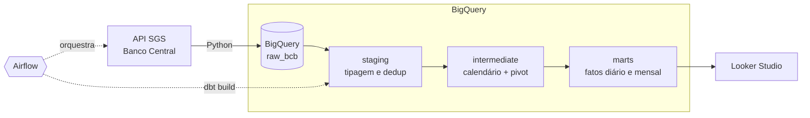

# Pipeline de Indicadores Econômicos do Banco Central

Pipeline ELT de ponta a ponta que coleta diariamente a **Selic**, o **IPCA** e o **dólar** da API pública do Banco Central, carrega os dados brutos no **BigQuery**, transforma e testa com **dbt** e orquestra tudo com **Apache Airflow**.

O resultado são duas tabelas prontas para análise: uma visão diária de juros e câmbio e uma visão mensal de inflação acumulada e **juro real ex-post**.


## Arquitetura



| Camada | Ferramenta | Papel |
|---|---|---|
| Extração e carga | Python + `google-cloud-bigquery` | Lê a API do SGS e grava os dados **sem transformação** no dataset `raw_bcb` |
| Armazenamento | BigQuery (Sandbox) | Warehouse em nuvem, sem custo |
| Transformação | dbt Core | SQL versionado em camadas, com testes e documentação |
| Orquestração | Apache Airflow (Astro CLI) | Agenda a execução em dias úteis, ordena as etapas e faz retentativas |
| Qualidade | dbt tests + pytest + GitHub Actions | 22 testes de dados, testes unitários e CI a cada pull request |

## Modelos

```
models/
├── staging/
│   └── stg_bcb__series_sgs            texto -> DATE/NUMERIC, remoção de duplicatas
├── intermediate/
│   └── int_indicadores__diarios       calendário contínuo, pivot e forward fill do câmbio
└── marts/
    ├── fct_indicadores_diarios        Selic, dólar, variação diária, média móvel 21 dias úteis
    └── fct_inflacao_juro_real_mensal  IPCA mês/ano/12m, Selic média e juro real (Fisher)
```

Os testes cobrem unicidade e nulidade das chaves, valores aceitos, faixas plausíveis (`dbt_utils.accepted_range`), *freshness* da fonte e um teste singular que impede datas no futuro.

## Decisões de projeto

- **ELT com camada raw imutável.** A ingestão grava os valores como texto, exatamente como vêm da API. Toda conversão de tipo e regra de negócio fica no dbt, onde é versionada e testada.
- **Carga full refresh e idempotente.** Cada execução substitui a tabela raw (`WRITE_TRUNCATE`). Rodar duas vezes dá o mesmo resultado, e a carga é abortada se a API não devolver nada, para não apagar dados bons.
- **Compatível com o BigQuery Sandbox.** O Sandbox não aceita DML (`INSERT`/`MERGE`), então não há modelos incrementais; o volume (alguns milhares de linhas) torna o full refresh trivial.
- **Janelas de 5 anos na extração.** A API do SGS limita consultas de séries diárias a 10 anos por requisição.
- **Acumulados compostos corretos.** O IPCA de 12 meses é calculado como produto de `(1 + taxa)` via `exp(sum(ln(...)))`, e só é publicado quando a janela tem 12 meses completos.
- **dbt isolado em virtualenv** dentro da imagem do Airflow, evitando conflito de dependências.
- **Nenhum segredo no repositório.** Credenciais entram por variáveis de ambiente e pelo GitHub Secrets.

## Como executar

### Pré-requisitos

- Conta Google e um projeto no [Google Cloud](https://console.cloud.google.com/) com o BigQuery Sandbox ativo (não precisa de cartão)
- [Docker](https://docs.docker.com/get-docker/) e [Astro CLI](https://www.astronomer.io/docs/astro/cli/install-cli)
- Python 3.11+

### 1. Credenciais do GCP

1. No console do GCP, crie uma **service account** com os papéis *BigQuery Data Editor* e *BigQuery Job User*.
2. Gere uma chave JSON e salve em `include/gcp/service_account.json` (a pasta está no `.gitignore`).
3. Copie o arquivo de variáveis e preencha o ID do projeto:

```bash
cp .env.example .env
```

### 2. Subir o Airflow

```bash
astro dev start
```

Acesse `http://localhost:8080`, ative a DAG `pipeline_indicadores_bcb` e dispare uma execução manual.

### 3. Desenvolver o dbt localmente (opcional)

```bash
python -m venv .venv && source .venv/bin/activate
pip install "dbt-bigquery==1.12.*"
gcloud auth application-default login
export GCP_PROJECT_ID=seu-projeto

cd dbt
dbt deps --profiles-dir .
dbt build --profiles-dir .            # target dev, schemas dbt_dev_*
dbt docs generate --profiles-dir . && dbt docs serve --profiles-dir .
```

### 4. Testes da ingestão

```bash
pip install requests google-cloud-bigquery pytest
python -m pytest
```

## CI

A cada pull request o GitHub Actions roda lint (ruff), testes unitários e `dbt parse`. Em pushes na `main`, se o segredo `GCP_SA_KEY` (conteúdo do JSON da service account) e a variável `GCP_PROJECT_ID` estiverem configurados no repositório, roda também o `dbt build` contra o BigQuery.

## Fonte dos dados

[Sistema Gerenciador de Séries Temporais (SGS)](https://www3.bcb.gov.br/sgspub/) do Banco Central do Brasil:

| Código | Série |
|---|---|
| 432 | Meta da taxa Selic definida pelo Copom (% a.a.) |
| 433 | IPCA, variação mensal (%) |
| 1 | Dólar americano, taxa livre, venda (R$) |

## Próximos passos

- Dashboard no Looker Studio sobre os marts
- Novas séries (CDI, IGP-M, câmbio do euro)
- Carga incremental com particionamento ao sair do Sandbox
